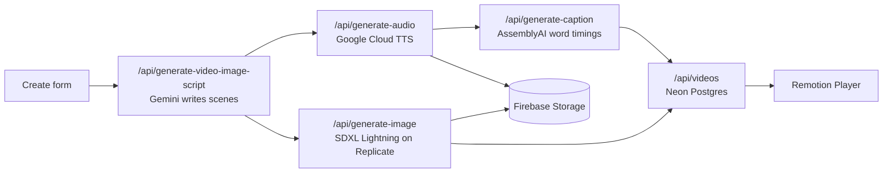

<div align="center">


# Clipkar

**Turn a topic into a narrated, captioned short video in about a minute.**

[Live app](https://clipkar.vercel.app/) · [How it works](#how-it-works) · [Run it locally](#run-it-locally)


</div>

## What it does

Clipkar is an AI shorts generator. Pick a topic, an art style and a length, and it writes a script, illustrates every scene, records a voiceover, times word-level captions to it and plays the finished vertical video in the browser. Every short you make is saved to your dashboard so you can watch it again later.

| Step | You choose |
| --- | --- |
| **01 Topic** | Random AI Story, Scary Story, Historical Facts, Bed Time Story, Motivational, Fun Facts, Kids Story, or write your own |
| **02 Style** | Realistic, Cartoon, Comic, GTA, Imaginary, Watercolor |
| **03 Duration** | 15, 30, 45 or 60 seconds |

## How it works



1. **Script.** Gemini returns JSON: a list of scenes, each with an `imagePrompt` and the `contentText` to narrate. The prompt includes your topic, style and duration.
2. **Voiceover.** The narration for all scenes is joined and sent to Google Cloud Text-to-Speech. The MP3 is uploaded to Firebase Storage.
3. **Captions.** AssemblyAI transcribes that MP3 and returns the start and end time of every word, so captions line up exactly with the voice.
4. **Images.** Each scene's prompt goes to ByteDance's SDXL Lightning (4-step) model on Replicate at 1024 × 1280. Images are copied into Firebase Storage so the links don't expire.
5. **Save.** Script, audio URL, captions and image URLs are stored as one row in Postgres, tied to your account.
6. **Play.** A Remotion composition shows each image for its share of the audio, with the active caption on top, at 30 fps in a 2:3 frame. The video length comes from the last caption's end time.

The create page shows progress through each stage (script → voiceover → captions → images), with a running count of scenes illustrated.

## Tech stack

| Area | Tools |
| --- | --- |
| Framework | Next.js 15 (App Router), React 19, TypeScript |
| UI | Tailwind CSS, shadcn/ui (Radix), Lucide icons |
| Video | Remotion 4 and `@remotion/player` |
| Script | Google Gemini (`@google/generative-ai`) |
| Voice | Google Cloud Text-to-Speech |
| Captions | AssemblyAI |
| Images | Replicate (`bytedance/sdxl-lightning-4step`) |
| File storage | Firebase Storage |
| Database | Neon serverless Postgres with Drizzle ORM |
| Auth | Clerk |

## Run it locally

You need Node.js 22 (see `.nvmrc`; `package.json` accepts 20–24) and accounts with the services above. Most have a free tier.

```bash
git clone https://github.com/Stroller15/clipkar-ai.git
cd clipkar-ai
npm install
```

Create `.env.local`:

```bash
# Clerk
NEXT_PUBLIC_CLERK_PUBLISHABLE_KEY=
CLERK_SECRET_KEY=

# Neon Postgres
DATABASE_URL=

# AI services
NEXT_PUBLIC_GEMINI_API_KEY=
TTS_API_KEY=              # Google Cloud API key with Text-to-Speech enabled
ASSEMBLY_AI_API_KEY=
REPLICATE_API_KEY=

# Firebase (web app config)
NEXT_PUBLIC_FIREBASE_API_KEY=
NEXT_PUBLIC_FIREBASE_AUTH_DOMAIN=
NEXT_PUBLIC_FIREBASE_PROJECT_ID=
NEXT_PUBLIC_FIREBASE_STORAGE_BUCKET=
NEXT_PUBLIC_FIREBASE_MESSAGING_SENDER_ID=
NEXT_PUBLIC_FIREBASE_APP_ID=
NEXT_PUBLIC_FIREBASE_MEASUREMENT_ID=
```

Create the database tables, then start the dev server:

```bash
npm run db:push
npm run dev
```

Open [http://localhost:3000](http://localhost:3000), sign up, and go to **Dashboard → Create**.

### Scripts

| Command | What it does |
| --- | --- |
| `npm run dev` | Start the dev server |
| `npm run build` / `npm start` | Production build and server |
| `npm run lint` | ESLint |
| `npm run db:push` | Apply the Drizzle schema to the database |
| `npm run db:generate` | Generate a SQL migration from the schema |
| `npm run db:studio` | Open Drizzle Studio to browse the data |

## Project structure

```
app/
  (auth)/                   Clerk sign-in and sign-up
  (root)/dashboard/         Video library, create flow, account, plans
  api/
    generate-video-image-script/   Gemini script
    generate-audio/                Text-to-speech → Firebase
    generate-caption/              AssemblyAI word timings
    generate-image/                Replicate → Firebase
    videos/, users/                Postgres reads and writes
components/
  custom/                   App shell, video list, player dialog, Remotion composition
  ui/                       shadcn/ui primitives
config/                     Gemini, Firebase and Drizzle setup
drizzle/                    SQL migrations
remotion/                   Remotion root for rendering outside the browser
middleware.ts               Protects /dashboard and /api with Clerk
```

## Notes

- All `/dashboard` pages and `/api` routes require a signed-in user. Videos are listed and saved by the account's email, which comes from the session, never from the request body.
- Paid plans aren't available yet. Everyone is on the free plan.
- A 60-second short makes several image calls to Replicate, which is the slowest and most expensive step.
